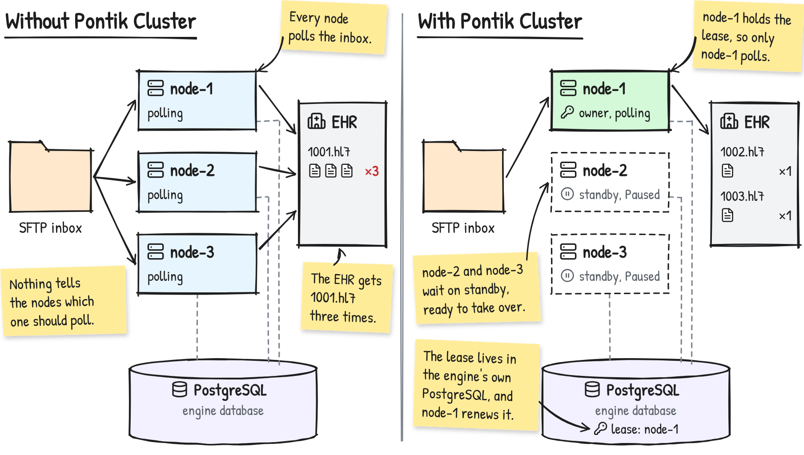
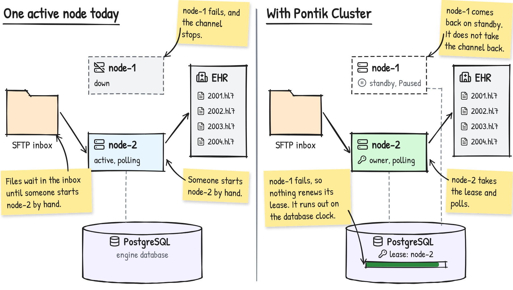

# Pontik Cluster

[](LICENSE)

## Introduction

Pontik Cluster is a plugin for Eclipse Open Integration Engine™, the open-source
healthcare integration engine. It makes sure at most one node of your cluster starts a
poll for each channel you protect, with automatic failover. It can protect a channel
whose source connector polls - a File Reader, a Database Reader or a JavaScript
Reader - and when a channel's settings rule that out, it tells you why. When the node
polling a channel stops, another node takes the channel over.

Out of the box, Open Integration Engine™ - like Mirth® Connect, which it was forked
from - does not coordinate the nodes of a cluster. When you run it active-active, with
every node sharing one database and running the same channels at the same time, every
node polls those channels on its own, so two nodes can read the same file or row.
Channels that listen, such as an HTTP or TCP Listener, do not have this problem when
your load balancer sends each message to one node. Pontik Cluster lets you keep every
node active, instead of falling back to active-passive, where one node works while the
others wait, or splitting your channels across nodes by hand.

<picture>
  <source media="(max-width: 767px) and (prefers-reduced-motion: reduce) and (prefers-color-scheme:dark)" srcset="art/pontik-cluster-polling-narrow-dark.png 2x">
  <source media="(max-width: 767px) and (prefers-reduced-motion: reduce)" srcset="art/pontik-cluster-polling-narrow-light.png 2x">
  <source media="(max-width: 767px) and (prefers-color-scheme:dark)" srcset="art/pontik-cluster-polling-narrow-dark.svg">
  <source media="(max-width: 767px)" srcset="art/pontik-cluster-polling-narrow-light.svg">
  <source media="(prefers-reduced-motion: reduce) and (prefers-color-scheme:dark)" srcset="art/pontik-cluster-polling-dark.png 2x">
  <source media="(prefers-reduced-motion: reduce)" srcset="art/pontik-cluster-polling-light.png 2x">
  <source media="(prefers-color-scheme: dark)" srcset="art/pontik-cluster-polling-dark.svg">
  <source media="(prefers-color-scheme: light)" srcset="art/pontik-cluster-polling-light.svg">
  
</picture>

## How It Works

Your cluster stays active-active: every node keeps running and serving traffic. What
changes is which node polls a protected channel. For each one, Pontik Cluster keeps a
lease in your engine's database - a record that lets one node, the channel's owner,
poll the channel for a limited time - and the owner renews it as long as it keeps
running and reaches the database. Every other node is on standby for that channel. It
keeps the channel deployed with its source connector stopped, so the channel shows as
Paused there, and it takes the channel over once the lease runs out. Your nodes never
connect to each other. The database alone decides who owns each channel.

The database's clock decides when a lease runs out, so your nodes' clocks do not need
to agree on the time of day. The owner stops polling six seconds before its lease could
run out, timed on its own monotonic clock, which measures elapsed time and ignores any
change to the time of day.

When you stop a node cleanly or undeploy a channel on its owner, the owner hands the
channel over. It gives up the lease once its source connector has stopped, and a node
on standby takes the channel over. When a node fails or loses its database, the
channel fails over instead. The other nodes wait for the lease to run out, and then one
of them takes the channel over. Either way, the new owner polls at the channel's next
scheduled poll. There is no automatic failback: when a node comes back, the channels it
gave up stay with their new owners. After you restart every node at once, each
protected channel polls again about 20 seconds after it is deployed.

<picture>
  <source media="(max-width: 767px) and (prefers-reduced-motion: reduce) and (prefers-color-scheme:dark)" srcset="art/pontik-cluster-failover-narrow-dark.png 2x">
  <source media="(max-width: 767px) and (prefers-reduced-motion: reduce)" srcset="art/pontik-cluster-failover-narrow-light.png 2x">
  <source media="(max-width: 767px) and (prefers-color-scheme:dark)" srcset="art/pontik-cluster-failover-narrow-dark.svg">
  <source media="(max-width: 767px)" srcset="art/pontik-cluster-failover-narrow-light.svg">
  <source media="(prefers-reduced-motion: reduce) and (prefers-color-scheme:dark)" srcset="art/pontik-cluster-failover-dark.png 2x">
  <source media="(prefers-reduced-motion: reduce)" srcset="art/pontik-cluster-failover-light.png 2x">
  <source media="(prefers-color-scheme: dark)" srcset="art/pontik-cluster-failover-dark.svg">
  <source media="(prefers-color-scheme: light)" srcset="art/pontik-cluster-failover-light.svg">
  
</picture>

You opt in one channel at a time by choosing its mode:

| Mode | Behavior |
| --- | --- |
| `unmanaged` | The plugin does nothing. This is the default for every channel. |
| `single-owner` | At most one node starts a poll for the channel's source connector. |

Only a channel whose source connector polls can be protected. A channel that listens
keeps running on every node behind your load balancer, as it does today. If you try to
set its mode to `single-owner`, we refuse the change, and the channel stays `unmanaged`.
If you later change a `single-owner` channel's source to a listener and redeploy it,
each node runs the channel as it would without the plugin and reports it as
`unprotected`, with fault code PC-112.

Installing the plugin changes no channel's behavior until you set its mode, and
removing it from every node returns every channel to the engine's own behavior. The
plugin keeps its state in three tables of its own in the engine's database, `pcl_node`,
`pcl_lease` and `pcl_channel_config`, which stay there until you drop them. Pontik
Cluster only ever prevents a read. It never deletes, moves, acknowledges or reorders a
message, and it never writes to any of the engine's own tables.

You always know where a `single-owner` channel stands. Each node reports it as either
`protected` or `unprotected`, with the reason, and raises a fault code when you must
act.

## Requirements

Pontik Cluster runs on two or more Open Integration Engine™ 4.6.0 servers - we call each
one a node - that share one PostgreSQL engine database. It adds no server and no
network path between your nodes: each node opens two more connections to the database
it already uses.

Before you install it, please make sure that:

- Every node runs Open Integration Engine™ 4.6.0 exactly, and every node runs the
  plugin, at the same version. A node without the plugin polls every channel, whatever
  its mode.
- Each node keeps its own `appdata` and `conf` directories from one start to the next,
  so it keeps its own server ID and its keystore passwords, and the
  `server.id.ephemeral` setting stays off.
- The database's clock runs continuously and is kept on time by NTP, and so is the clock
  of its standby server, if you run one.
- Each node reaches the database in well under a second, as it does on the same network
  or in the same cloud region.
- Each node connects to PostgreSQL directly, not through PgBouncer or another connection
  pooler.
- Nothing but the plugin locks rows in its three tables.
- The engine's database user may create tables, or your database administrator runs the
  schema script from [Installation](#installation) first.
- Every channel you protect is deployed on every node that may take it over. A channel
  deployed on only one node has no failover, and no other node can warn you when that
  node fails.
- Every node reaches the same source - the same share, directory, database or endpoint -
  because the new owner reads from its own side.
- Each node can run every protected channel on its own, because after a restart one
  node may own them all.

## Installation

You install Pontik Cluster like any other Open Integration Engine™ extension, from its
zip, `pontik-cluster-0.1.0-alpha.zip`. You may build the zip yourself: open this
repository in its devcontainer, as [CONTRIBUTING.md](CONTRIBUTING.md) describes, and run
`./gradlew pluginZip`. The zip lands in `plugin/build/distributions/`.

Please repeat these steps on every node. First, open Extensions in the Administrator,
choose the zip under Install Extension from File System, and click Install. Next,
restart the engine on that node. Finally, check that the Extensions list on that node
shows Pontik Cluster.

At its first start, the plugin creates its three tables in the engine's database:
`pcl_node`, `pcl_lease` and `pcl_channel_config`. If the engine's database user may not
create tables, the node raises fault code PC-107 instead and runs every channel as it
does without the plugin. In that case, please ask your database administrator to run
this schema script once, in the schema your engine's own tables use, replacing
`engine_user` with the user your engine connects as, and then restart the node:

```sql
-- Keep timestamp without time zone: the plugin compares these columns
-- with the database clock in UTC and refuses any other type.

CREATE TABLE pcl_node (
    node_id varchar(255) PRIMARY KEY,
    node_name varchar(255) NULL,
    instance_id varchar(36) NOT NULL,
    protocol_version int NOT NULL,
    plugin_version varchar(32) NOT NULL,
    last_seen_at timestamp NOT NULL
);

CREATE TABLE pcl_lease (
    channel_id varchar(36) PRIMARY KEY,
    owner_node_id varchar(255) NULL,
    epoch bigint NOT NULL DEFAULT 0,
    lease_expires_at timestamp NOT NULL,
    acquired_at timestamp NULL,
    stopped boolean NOT NULL DEFAULT false
);

CREATE TABLE pcl_channel_config (
    channel_id varchar(36) PRIMARY KEY,
    mode varchar(16) NOT NULL,
    rereadable boolean NOT NULL DEFAULT false,
    updated_at timestamp NOT NULL,
    updated_by varchar(255) NULL
);

GRANT SELECT, INSERT, UPDATE ON pcl_node, pcl_lease, pcl_channel_config TO engine_user;
GRANT DELETE ON pcl_channel_config TO engine_user;
```

> [!NOTE]
> If a time column was created as `timestamp with time zone`, the node raises PC-107 and
> names the column. You may convert it in place, keeping its values in UTC, with
> `ALTER TABLE pcl_lease ALTER COLUMN lease_expires_at TYPE timestamp USING lease_expires_at AT TIME ZONE 'UTC';`,
> using the table and column the message names.

> [!WARNING]
> Please keep every node on Open Integration Engine™ 4.6.0 while you use this release.
> The engine loads an extension only on the exact engine version the extension names,
> and it skips one that does not match with a single line in its log. A node on another
> engine version then polls every protected channel, while the other nodes keep
> reporting it `protected`. After you upgrade the engine or the plugin, please check the
> Extensions list on every node.

## Uninstalling

If you remove Pontik Cluster, please hand every protected channel back first, so each
node starts polling again because you decided it, not because of the order of your
uninstalls.

First, set the mode of every protected channel to `unmanaged`, as
[Protecting a Channel](#protecting-a-channel) shows, and wait 20 seconds. Next, on each
node in turn, open Extensions in the Administrator, click Uninstall on Pontik Cluster,
and restart the engine. Finally, once every node is done, you may drop the plugin's
tables:

```sql
DROP TABLE pcl_lease, pcl_channel_config, pcl_node;
```

Your channels then run as they do without the plugin.

## Protecting a Channel

You protect a channel by setting its mode to `single-owner` through our REST call, and
hand it back by setting it to `unmanaged`. You may call it on any node; every node picks
the change up within about 10 seconds:

```
PUT /api/extensions/pontik-cluster/channels/{channelId}/mode?mode=single-owner
```

For example, with curl:

```shell
curl -X PUT -u admin -H 'X-Requested-With: OpenAPI' \
  'https://engine-1.example.org:8443/api/extensions/pontik-cluster/channels/CHANNEL_ID/mode?mode=single-owner'
```

curl asks for the user's password. The examples assume that the machine you run curl
on trusts your engine's certificate. A successful call answers `204 No Content`. On a
stock engine every user who may log in may also make this call; its permission, Set
cluster mode, matters only if you run an extension that restricts permissions.

We check the saved channel before we change anything, and we refuse a channel we cannot
protect with `422` and the fault code that says why, in plain text:

| Code | We Refuse the Channel When | What You May Do |
| --- | --- | --- |
| PC-106 | Poll Once on Start is on, or the Database Reader runs its post-processing once after all messages | Turn the setting off, or keep the channel `unmanaged` |
| PC-112 | Its source connector is not a File Reader, a Database Reader or a JavaScript Reader | Keep the channel `unmanaged` |
| PC-114 | Its read may change data - a JavaScript Reader, a Database Reader with Use JavaScript set to Yes, or a query that writes - and you have not declared it rereadable | Declare it rereadable if that is safe, or keep it `unmanaged` |
| PC-115 | A Channel Writer sends messages into it | Route those messages another way, or keep the channel `unmanaged` |

A channel is rereadable when a read we stop partway leaves its data in place to be read
again, such as a script that only reads files and never deletes them. You declare it in
the same call:

```
PUT /api/extensions/pontik-cluster/channels/{channelId}/mode?mode=single-owner&rereadable=true
```

The call also answers `400` for any other mode, `404` for a channel that does not exist,
and `503` while the plugin is off on that node. A change the database refuses twice
answers `500`, with the database's SQLState.

Once you protect a channel, your nodes settle on one owner within about 20 seconds.
Until then, a node that has not caught up may still poll it, and that node reports the
channel as `unprotected`.

## Limitations

> [!WARNING]
> Pontik Cluster reduces duplicate polling, but it cannot rule it out entirely. A poll
> that is already in flight when a node loses its lease can finish after the new owner
> has started. Two nodes can also poll at the same time if a node freezes for several
> seconds at the wrong moment - during a long garbage-collection pause, for example -
> or if its clock runs much slower than the database's.

Closing that window would require the polled system itself to turn away a node that has
lost its lease, and you cannot ask that of an SFTP server or a partner's database. If
you need each message processed exactly once, you should make sure your destinations
are idempotent, which means that receiving the same message twice has the same effect
as receiving it once.

Channels that listen depend on each message reaching one node. A JMS Listener that
subscribes to a topic can receive every message on every node, and we refuse to protect
it, because it does not poll. If you can, you should have it read from a queue instead,
since a queue hands each message to one node.

Pontik Cluster is provided as-is, without warranty of any kind, and no fitness for any
purpose, clinical or otherwise, is asserted. It is not a medical device, is not
certified as one, and does not replace the safety controls of the systems it runs
alongside. Please validate it in your own environment before it carries live traffic.

## Trademarks

Eclipse, Open Integration Engine and OIE are trademarks of Eclipse Foundation AISBL.
Mirth and Mirth Connect are trademarks of NXGN Management, LLC. We use these names
only to identify the engine this plugin runs on and the software that engine was
forked from. Other names belong to their respective owners. Pontik Cluster is not
affiliated with, endorsed by, or sponsored by any of them.

## Contributing

Thank you for considering contributing to Pontik Cluster! The contribution guide can
be found in [CONTRIBUTING.md](CONTRIBUTING.md).

## Security Vulnerabilities

Please review [our security policy](SECURITY.md) on how to report security
vulnerabilities.

## License

Pontik Cluster is open-sourced software licensed under the
[Mozilla Public License 2.0](LICENSE).
